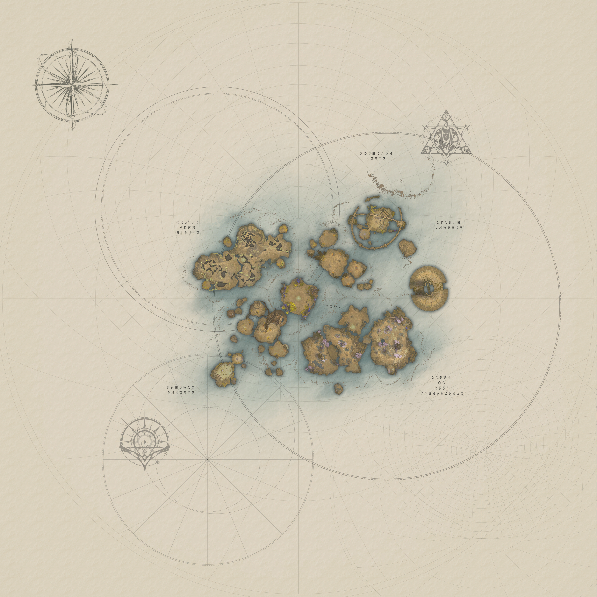

# Abyss Planner (alpha)

A self-contained, no-build route & travel-time planner for **Aion 2's Abyss — Reshanta A** (Global, Nov 2026 client). No installs, no accounts — just open the page.



## What it does

Shows the game's **own world-map artwork** (extracted from the client's sector textures and stitched at its exact surveyed coordinates) with datamined teleporter positions, bases, and region labels overlaid. Click points on the map to trace a flight path and get **real distance and travel-time estimates** at Aion 2's actual flight speeds — all computed on the horizontal plane (x/y only; z is ignored, i.e. level flight above the pads).

## Features

| | |
|---|---|
| **Exact client map** | Background is the shipped 4×4 sector art at 0.996 m/px — teleporter pins sit where the game puts them. No calibration step exists because none is needed. |
| **Route drawing** | Click to drop waypoints. Click-and-hold any waypoint to drag it. Undo / Reset buttons. |
| **Travel times** | Live table for the three movement modes — Fly **12 m/s**, Sprint-fly **16 m/s**, Dash-fly **24 m/s** (client `GlobalSetting` base values) — plus per-segment distances and a flight-energy (FP) estimate. |
| **Flight rings** | Toggle shows all 49 ring locations; while shown, any route segment crossing a ring is credited a **×1.5 speed boost** and the panel reports how many segments were boosted. |
| **Markers** | "Add marker" mode drops persistent pins with a custom label, coordinates below, **8 colors × 8 icons** (dot, square, triangle, diamond, star, flag, loot, danger). Click a marker to rename, right-click (or alt+click) to delete. |
| **Coordinates** | Hover readout in meters (map center = 0,0); gridlines every 100 m / 500 m. |
| **Light & dark themes** | Sepia-paper light mode and a dark mode; choice is remembered. |
| **Share links** | 🔗 Share link compresses your route, markers (labels/colors/icons) and all settings into the URL itself — recipients open it and see exactly your layout. No backend, no accounts. |

## How to use

1. Click the map to start a route → the **Route** and **Estimated time** panels update live; pick a speed mode with the buttons.
2. Drag any dropped point to fine-tune it.
3. **◉ Flight rings** — turn on to visualize rings and apply ring boosts to the time estimates.
4. **📍 Add marker** — style it in the revealed picker, then click to place. Markers persist in your browser (localStorage) and are scoped to the site/origin — they don't sync between devices.
5. **🔗 Share link** — copies a URL with your entire board encoded in it. Anyone opening the link gets your route, markers and toggles; from there they can edit freely without changing your original.

## Data & provenance

- **Teleporters, bases, labels, map art, sector geometry** — extracted from the Aion 2 client (GAME DATA). Sector georeference from `Data/WorldMap/Abyss_Reshanta_A.json`.
- **Ring positions** — community mapping (shugo.gg), ~35 m RMS agreement with client coordinates (PLAYER TEST).
- **Ring boost ×1.5 and 40 m trigger radius** — modelled from community observation, **UNVERIFIED**: the client ships no ring speed field. Tune to your own measurement if you have one.
- **FP cost rates** — ratios (1 : 2 : 8 for fly/sprint/dash) are GAME DATA; the absolute scale is **UNVERIFIED**.

## Files

```
abyss-planner/
├── index.html                # the planner (self-contained)
├── reshanta_client_raw.png   # 4096² stitched client map (7.6 MB)
└── README.md
```

*Not affiliated with NCSoft/PlayNC. Game assets belong to their respective owners.*
